# Daily clip research and YouTube source planning

Implemented 2026-10-08; workflow map and usable research briefs added 2026-10-09. Open `http://127.0.0.1:8000/` after starting `.\.venv\Scripts\python.exe -m clipping` from the project root.

## Choose and prepare a video

1. Enter an actual Content Rewards campaign brief, including source permission and any duration limits. Work across whichever niches the campaigns permit; their actual reward terms are separate from social engagement.
2. Under **Choose a YouTube source**, paste a single HTTPS video link and click **Check YouTube video details**. It returns a title, creator and duration without downloading media. It does not verify clipping rights. An authorized uploaded MP4/MOV/MKV/WebM is also supported if network lookup is unavailable.
3. Choose the desired clip length and format. Add optional comma-separated niche keywords. Enable the automatic transcript-window option. For the installed `tiny.en` model, select English; other languages need the multilingual model or matching SRT.
4. Create the review task and approve the campaign/source rights. The worker prepares the source, transcribes it or waits for subtitles, suggests up to three complete windows, selects one, renders subtitles and validates the video. A missing/failed transcript never becomes an invented real transcript.
5. Review the rendered clip, context, crop, captions and campaign requirements. The selected time range and alternatives are saved in the job and in **Download cut suggestions**. Choosing an alternative copies the original source/campaign into a fresh intake; creating that job still requires approval.
6. Publish and submit through the existing supervised handoffs. A rendered or approved clip does not establish public publication, campaign acceptance, payment or follower growth.

The source checker accepts individual `watch`, `shorts`, `embed`, `live` recordings and `youtu.be` links with a video ID. It rejects playlists, arbitrary hosts, embedded credentials and unusual ports. Live broadcasts without a recorded duration are unsuitable. URLs are canonicalized and yt-dlp configuration is ignored; no cookies or credentials are requested. Source inspection and download prefer the installed Python yt-dlp module over a standalone executable, avoiding a reproduced Windows unpacking failure.

## How the dataset works

The linked [dataset card](https://huggingface.co/datasets/kuben-developer/tiktok-videos-4b/blob/main/README.md) describes one metadata row per post, stored in compressed Parquet files. Its engagement counts are historical observations. It supplies neither video footage nor source transcripts, retention curves, creator follower counts or Content Rewards payouts. Current access returned 401; its binary records have not been imported or independently verified. See the [research assessment](../research/tiktok_videos_4b_research_2026-10-08.md) for the cached evidence and research-use terms.

The new importer accepts a **local CSV or JSONL export**, at most 25 MB and 100,000 records. Required fields:

| Field | Accepted value | Used for |
| --- | --- | --- |
| `content_id` | Unsigned integer or digit string, preserved as text internally | Duplicate detection |
| `create_time` | ISO timestamp including a timezone | Posting-month cohort, normalized to UTC |
| `duration` | Positive integer seconds | Fifteen-second duration bands |
| `views` | Nonnegative integer | Median historical views and rate denominators |

Optional fields: `desc`, `language`, `country`, `likes`, `comments`, `shares`, `saves`, `is_video`, `is_ad`. Missing country/language become unknown; absent, null or empty optional counts remain unknown. An explicit zero is a measured zero. Binary flags must be 0/1. The report excludes photo posts and advertising when their flags are provided. Other columns, including creator mentions and music titles, are ignored by this first version; raw captions and account identifiers are not included in returned reports or retained as uploaded files.

Use exact comma-separated topic phrases such as `AI, gaming, interview, fitness`. Matching respects word boundaries (`AI` does not match `air`). A caption can match more than one topic, so topic totals are not disjoint. Country/language filters use source labels; country is not verified audience geography. Records with missing/bad required fields are counted as invalid. Duplicate IDs keep the first valid row in the supplied sample.

The report groups posts by **topic + UTC posting month + language + country + duration band**. A group needs at least ten records. It shows support counts, median duration/views, median per-post share/view and save/view ratios, and the number of measured ratios. Zero-view posts remain in median views but are excluded from rate division. Unknown share/save counts are also excluded from the corresponding ratio. Rates describe only measured posts with positive views; they are not retention or conversion rates. Groups are ordered by support, not by a promised best niche.

The original files cluster creators' posts. A short prefix or `LIMIT` export is not automatically representative; obtain an appropriately drawn sample across shards and retain its sampling description. Parquet must be exported to the supported text formats using a capable reader. Direct Parquet ingestion and a remote downloader are not part of this version. A DuckDB installation attempt did not succeed in this environment, and the runtime deliberately has no new mandatory dependency. [Hugging Face streaming documentation](https://huggingface.co/docs/datasets/stream) explains column selection, filters and the limits of buffered shuffling.

**Try synthetic research demo** produces ninety artificial records across AI, gaming and interviews, solely to test the controls. The resulting table is explicitly marked synthetic; it establishes no niche or performance finding.

## Use the map and planning brief

The workspace's **How research becomes a clip** map shows both inputs and the selected run's saved source, subtitle, planning and preview checkpoints. A failed download does not mark subtitles or a preview ready. **Open research tools** expands the optional campaign and research controls directly; no new configuration is required for the automatic preview.

For an imported sample, the analyzer prepares one test brief automatically:

1. Select the month/language/country context with the largest single supported group. Overlapping topic counts are not added together. Equal support uses the latest posting month, then stable label ordering.
2. Within that context, compare median share/view ratios only when at least two groups have distinct ratios and each has ten measured positive-view posts. Otherwise use the most-supported group as a starting point, explicitly without inferring a performance winner. Ties favor support, then a typical length closer to 30 seconds, then stable topic/band ordering.
3. Suggest the selected group's actual median duration and topic keyword. Unknown language/country labels and groups with typical lengths above 180 seconds cannot supply a brief. A general sample without topic keywords can suggest a length but cannot identify a niche.

**Use brief for this campaign** copies the keyword and desired length into the campaign form and enables automatic transcript planning. Campaign limits bound the length; invalid bounds or an explicitly mismatched language stop the action. The source, format, spoken-language setting, caption/disclosure and campaign permissions remain the operator's supplied values. This action does not create or approve a job. The fixed automatic IShowSpeed preview continues to use its saved defaults.

Synthetic demo briefs have no apply action. No sample means no dataset-derived recommendation. The report and brief can be downloaded as JSON; uploads/reports are not saved across page reloads. Task inputs are saved when the campaign job is created, and selected transcript cuts retain their existing checkpoints.

## How a cut is suggested

The planner uses the operator's timed transcript, not the metadata corpus, to locate footage. It selects whole, non-overlapping subtitle cues within campaign duration limits, favors a question opening, concrete numbers/steps, chosen topic words, sentence endings and closeness to the desired length. It penalizes openings that may depend on previous context and suppresses heavily overlapping alternatives. Overlapping subtitle cues must be merged before automatic planning.

`editorial_score` is a transparent heuristic, not a trained model or probability of virality. Caption suggestions come from the operator's source opening, rather than other creators' captions. Applying a research brief supplies topic/length preferences to this existing planner; it does not train a model or prove that its chosen moment will perform well. The planner does not understand visual events, speaker framing, truthfulness, audience interest or campaign compliance. Review those before approving the clip.

```mermaid
flowchart LR
  Dataset[Optional accessible metadata export] --> Sample[Local CSV or JSONL sample]
  Sample --> Cohorts[Comparable historical cohorts]
  Cohorts --> Brief[One topic and length experiment]
  Brief --> Apply[Apply within campaign limits]
  Source[Automatic private test or authorized campaign source] --> Video[Prepared source video]
  Video --> Transcript[Actual timed source transcript]
  Apply --> Ideas[Explainable transcript cut suggestions]
  Transcript --> Ideas
  Ideas --> Render[Render selected cut and subtitles]
  Render --> Preview[Technical QA and local preview]
  Preview --> Stop[Private test complete]
  Preview --> Review[Campaign clip and required brand approval]
  Review --> Publish[Confirmed publication]
  Publish --> Submit[Campaign submission]
  Submit --> Reward[Record actual reward decision or payment]
```

For actual learning, record your own public posts' outcomes and compare deliberate caption/length experiments over time. This version has no analytics importer, daily scheduler, social posting adapter or automatic Whop submission. Campaign rates and confirmed payments remain separate from video-view statistics.

## API

- `POST /api/v1/clipping/research/sources`: JSON `url`; public source details, 422 for invalid URLs, 503 for an unavailable lookup.
- `POST /api/v1/clipping/research/reports`: multipart `file`, optional `keywords`, `language`, `country`; aggregate report including nullable `planning_brief` and explanatory `brief_note`.
- `GET /api/v1/clipping/research/demo`: clearly labeled synthetic report.
- `POST /api/v1/clipping/research/plans`: JSON `transcript_srt`, optional `source_duration`, `target_duration`, `min_duration`, `max_duration`, `keywords`; editable suggestions.
- Existing job intake additionally accepts boolean `auto_clip` and text `research_keywords`. Suggestions are generated only after campaign approval; selected plans survive restart and retry. Existing manual jobs keep their behavior.

## Verification

On 2026-10-09 the complete focused clipping suite passed **71 tests**. This includes within-context research recommendations, unknown metrics, sparse/unknown/too-long cohorts, demo exclusion, and an imported fixture brief feeding the approved workflow through actual FFmpeg rendering. Node interaction checks execute the shipped scripts to verify live map checkpoints and applying a brief while preserving source/caption/format, bounding duration and rejecting mismatched languages or invalid campaign limits. The local app returned HTTP 200 for the workspace, research script and demo report. Both JavaScript scripts passed syntax checks and HTML IDs are unique.

Visual verification remains **recapture**, with no desktop/mobile/narrow screenshots or visual approval. The existing Windows Chrome IPC restriction prevents capture. The one design-detector pass reported advisory mismatches for pre-existing palette literals and responsive type sizes; the map uses existing tokens. No live TikTok sample, source download, publication or reward was established by this change.

On 2026-10-08 the complete focused suite passed: **53 tests**, 62 warnings, no skips. The subsequent source-error visibility change passed the UI handoff/error interaction check and JavaScript syntax validation.

The focused clipping tests verify metadata rejection/deduplication, sparse groups, zero-view rates, source URL restrictions and lookup timeout handling, transcript windows, saved approvals/checkpoints, and actual FFmpeg rendering. The installed environment produced a real five-second 1080×1920 H.264/AAC synthetic demo with passing media checks; its job is **Clip planner - synthetic practice demo**, awaiting clip approval. The sample report contains ninety synthetic records. Its exported video is `storage/clipping/demos/research-planner-demo.mp4`.

The UI scripts pass Node syntax checks. An additional Node interaction check exercises alternative-cut source/campaign/disclosure preservation; this is not a full browser test. Playwright launch was denied with Windows error 5, so desktop/mobile layout and real browser interaction remain unverified. After correcting the standalone downloader failure, the Python module reaches a refused environment proxy; live source lookup returns HTTP 503 and successful external lookup/download remains unverified. Authorized uploads are independent of that lookup. No real campaign footage, live publication, actual dataset import, earned reward or viral outcome was tested.
