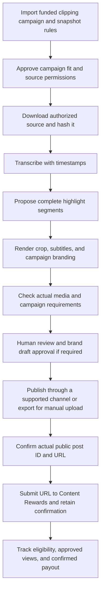

# Project assessment and clipping automation plan

Assessed: 2026-10-04. Scope: the original local snapshot, the supplied prior review, and current official platform documentation. The assessment below describes the legacy applications at the time of review.

Implementation update: the separate [clipping runtime](../clipping/README.md) now provides manual campaign intake, persisted approvals, background source preparation, optional local transcription with a real SRT fallback, FFmpeg rendering and media checks, operator publication/submission records, and reward confirmations. It includes a browser workspace and direct HTTP intake. Its built-in Python worker replaces n8n in the clipping deployment; start it with `python -m clipping`. The historical plan below originally proposed n8n, and those legacy files remain available. Clip selection and external publication/submission remain operator tasks. The focused tests and a running HTTP workflow passed; browser launch, Docker execution, and model downloads remain unverified. The legacy defects described below have not all been repaired.

Subtitle setup update (2026-10-05): runtime and transcription libraries are installed in `.venv` using cached wheels. A cached English `tiny.en` model is ready locally, with CPU decoder and speech activity detection checks completed. Start `.\.venv\Scripts\python.exe -m clipping` and select English to use it. SRT file import and a labeled three-caption practice demo are available. New model downloads remain blocked by the connection; multilingual `small` and actual-footage transcription accuracy are still unverified.

## Verdict

The project has a useful skeleton: a FastAPI service, a dashboard, workflow definitions, n8n triggers, database models, and media workers. It is a prototype with serious execution failures and simulated integrations. It cannot currently be relied on to discover real campaigns, publish real clips, submit them to Content Rewards, or reconcile payouts without further implementation and verification.

The highest priority is one complete clipping workflow with truthful statuses. Adding more providers, agents, or unrelated revenue workflows would increase the surface area before the basic workflow works.

## What is present and what is missing

| Area | Evidence in the current snapshot | Required work |
| --- | --- | --- |
| Campaign discovery | `scripts/content_rewards_workers.py` URL and HTML discovery return empty lists. Manual input assigns fixed sample budgets, rates, and platforms. `project/skills/campaign_research/skill.py` returns mock campaigns. | Import a real campaign and retain its actual rules, source assets, reward terms, and identity. Unknown financial fields must stay unknown. |
| Media rendering | The script workers contain real yt-dlp and FFmpeg subprocesses. | Repair artifact deduplication, square output, source identity, and dry-run behavior. Validate an actual output with ffprobe. |
| Transcription and highlight selection | `project/skills/video_processing/skill.py` creates a mock transcript and fixed candidates with mock scores. The configured script workflow does not include a real transcription stage. | Wire real timestamped transcription and select complete moments with context; save human-editable clip plans. |
| Approval | YAML gates target `publish`, but the workflow invokes `social_connector_publish`. Approval decisions and waiting-step checkpoints are not persisted. | Bind approval to the exact artifact, caption, target account, and workflow step; resume after approval without rerunning earlier work. |
| Workflow execution | The orchestrator ignores requested single steps, overwrites caller inputs with YAML defaults, and creates scheduled jobs without an API queue consumer. | Introduce durable execution checkpoints, a queue consumer, request-specific sessions, correct input merging, and stable idempotency. |
| n8n handoff | The request uses `workflowId` and `idempotencyKey`; the API requires `workflow_id` and accepts `idempotency_key`. | Align the request contract and pass the webhook body deliberately. Use campaign/source/variant identity instead of a fresh timestamp for duplicate detection. |
| Social publishing | Facebook, Instagram, and YouTube implementations contain simulated publication success. The connector worker supplies a `file://` media URL; the connector schema expects HTTP URLs. | Implement one real publishing path with actual upload, processing status, account selection, public URL, and independent confirmation. Use media bytes or a provider-accessible HTTPS URL as required. |
| Account connections | OAuth state is not retained or validated; PKCE and callback redirect handling are broken. Provider calls disable TLS verification. | Repair OAuth state, verifier retention, user binding, credentials, encryption imports, callback handling, and certificate verification before connecting real accounts. |
| Reward submission | `project/skills/submission/skill.py` inserts a local submission row but never calls its submission stub; the stub is empty. Draft approval is hardcoded true. | Track preparation separately from an actual platform submission. Require external submission evidence and real brand draft approval where applicable. |
| Analytics and payout | `scripts/real_pipeline.py` earnings tracking is a placeholder. The prior review identified analytics foreign-key and timestamp defects in the separate project implementation. | Store platform observations, Content Rewards eligibility decisions, and confirmed payments separately. Reconcile against official campaign/payout evidence. |
| Deployment and tests | API Docker dependencies omit yt-dlp and the connector client. The frontend configuration contains TypeScript in a JavaScript file. Main Compose does not run a reachable connector. | Make deployment reproducible and validate an isolated end-to-end scenario before enabling scheduled publication. |

These findings are grouped from direct code inspection and the earlier review; they are not a claim that all previously reported defects were independently reproduced in this pass.

## Research implications

Apply the selected campaign's governing terms. Content Rewards and Whop have separate roles; general Whop API access does not establish a Content Rewards submission integration. See the [current creator terms](https://contentrewards.com/terms) and the companion research note.

The research did not establish a documented public Content Rewards campaign-discovery, creator-submission, or reward-metrics API. Start with manual campaign import and a human submission task. Ask the operator for a supported integration before designing an automated submission adapter; do not treat undocumented endpoints or a browser stub as a completed integration. Detailed platform findings are recorded in [whop_clipping_research.md](whop_clipping_research.md).

Whop describes clipping as repurposing longer videos into short clips, including business and entrepreneurship content. This supports the choice of a clipping workflow, but its promotional earnings examples do not establish expected income. [Whop clipping guide](https://whop.com/blog/what-is-content-clipping/).

## Recommended starting niche

**Authorized AI/software demos and founder interview clips for people building small businesses.** This is a practical starting recommendation, not a demonstrated highest-paying niche. Restrict the first pilot to one of those formats, one campaign, and one language that the campaign permits and the editor can accurately review.

Why this fits the proposed system:

- Interview speech and demonstrations can provide complete, self-contained moments that transcript-based selection can propose.
- A clear problem, demonstration, and result gives the editor a repeatable selection rubric.
- The same audience can remain relevant across software products and founder campaigns without turning the channel into unrelated reposts.
- Actual approved assets and editing requirements can define which moments are usable.

The official directory displayed **Lovable Clipping at $1/1K** during research. It also displayed gaming, business, music, and entertainment campaigns. These are listing snapshots; detailed eligibility, remaining funds, assets, and approval rules must be checked inside the selected campaign before work begins. [Content Rewards Discover](https://contentrewards.com/discover).

Record campaign permission for the footage before clipping or distributing it. [Current creator terms](https://contentrewards.com/terms).

## Proposed workflow

| Stage | Automation responsibility | Evidence needed to advance |
| --- | --- | --- |
| Campaign intake | n8n form/webhook to FastAPI; import selected campaign details. | Campaign identity, current rules, deadline, funds, platform, and accepted source assets. |
| Permission review | Dashboard approval task. | Saved permission and campaign acceptance; unresolved questions remain waiting. |
| Source ingestion | Python worker downloads an authorized asset into durable storage. | Existing canonical file, source identity, SHA-256, duration, and media probe. |
| Transcript | A real local transcription engine, replacing the mock implementation. | Timed transcript linked to the source and the model/configuration used. |
| Highlight planning | Ollama may propose segments using transcript text and campaign rules. | Valid start/end times, complete context, hook, reason for selection, and target platform. |
| Rendering | FFmpeg cuts and reframes; subtitles are derived from the real timed transcript. | Actual MP4, readable subtitle placement, campaign branding, artifact hash, and render settings. |
| QA | ffprobe plus rule checks and preview review. | Duration, dimensions, aspect ratio, audio, captions, required tags/disclosure, and an explicit approval. |
| Brand draft review | Human task only when that campaign requires pre-post review. | The brand's actual approval; this differs from the operator approving the clip. |
| Publishing | One supported provider first; otherwise export a publication package. | Real platform post ID, selected account, actual public URL, and finished processing. |
| Reward submission | Human submission initially; a supported adapter later if available. | Content Rewards submission ID/status or recorded platform confirmation. A local database insert is insufficient. |
| Tracking | Scheduled checks or manual imports from permitted sources. | Submission-specific eligibility and verified views; separate estimated, approved, and received amounts. |

Proposed default format: 9:16, 1080x1920, with a complete short moment and clear subtitles. Duration and branding must come from the campaign and target format rather than the current fixed 60-second test payload. Do not default every YouTube clip to 16:9 when producing Shorts.

Recheck campaign availability before publishing. The current application's creator FAQ specifies submitting the link within 30 minutes of posting. Arrange publication and submission together, with an operator available to complete the handoff. Confirm the selected experience's applicable rules; legacy campaigns can differ. [Current creator FAQ](https://contentrewards.com/creators).

## Roles of the existing components

- **n8n:** triggers, lightweight routing, and explicit waiting tasks. Its Wait node can persist waiting execution and resume through a webhook or form. Approval responses still need authentication and must refer to a specific persisted request. [n8n Wait documentation](https://docs.n8n.io/integrations/builtin/core-nodes/n8n-nodes-base.wait/).
- **FastAPI:** validates inputs, stores workflow state, exposes previews/status/approvals, and enqueues execution. A proposed run request should return a job reference quickly rather than running FFmpeg in the ASGI event loop.
- **Python execution worker:** claims durable queued work, runs downloads/transcription/FFmpeg, persists each stage, and resumes failed work safely. A scheduler alone does not consume a queue.
- **Ollama:** helps suggest highlights and captions. Model output is a proposal to validate against source timestamps and campaign rules.
- **SQLite initially:** one canonical application schema, with a fresh session for each request/execution. Choose and document a canonical implementation before connecting the separate `project/` schema to the backend.
- **Storage:** keeps source, transcript, clip plan, render, and approval evidence by stable identity; retries must preserve existing canonical artifacts.
- **Social connector:** optional until a real provider is implemented and verified. Give it a separate URL/port and include its client in the API image if it remains a separate service.

## Posting constraints that affect the design

Google supports real uploads via `videos.insert`, but uploads from unverified API projects created after July 28, 2020 are restricted to private visibility until an audit lifts the restriction. A private upload is not a public reward submission. Begin with the official upload interface or an appropriately audited integration when necessary. [YouTube upload documentation](https://developers.google.com/youtube/v3/docs/videos/insert).

TikTok's Direct Post guidelines restrict unaudited clients and exclude private/internal upload utilities; they also reject copying arbitrary content from other platforms. A private multi-account clipping tool should not assume it qualifies merely by obtaining a client key. Evaluate the intended product against those guidelines and keep manual upload available. [TikTok Direct Post guidelines](https://developers.tiktok.com/docs/en/content-sharing-guidelines).

## Honest state and financial tracking

Use distinct records for campaign, source, transcript, clip, approval, publication, reward submission, and payout. Preserve both the campaign's external identifier and its internal database identifier with explicit field names.

Suggested submission states: `READY_TO_SUBMIT`, `SUBMITTED`, `APPROVED`, `REJECTED`, and `FLAGGED`, mapped to the actual external experience. Suggested payment categories: estimated, approved/unsettled, and received. A generated file is not a publication; a publication is not an approved reward; an approval is not proof of received funds.

For illustration, a hypothetical $1-per-1,000-eligible-views offer yields $10 gross for 10,000 eligible views. Accounting must apply the real campaign limits, validation, and fees. Replace the worker's fixed $5 rate with documented campaign data. [Campaign limits](https://contentrewards.com/brands-terms), [Creator fees](https://contentrewards.com/pricing/creators).

The project's local tooling can avoid paid AI services. Running it still uses hardware, storage, electricity, bandwidth, and editing time; the README's '$0 cost' claim does not measure operating cost.

## Ordered implementation work

1. **Make the runtime reproducible.** Establish version control; select a supported Python environment; install declared dependencies and yt-dlp; repair frontend configuration, model startup, and service addresses. Separate incompatible databases or migrate to one model deliberately.
2. **Repair execution controls.** Correct n8n field names, single-step dispatch, input merging, clip/campaign handoffs, queued execution, per-execution sessions, persistent checkpoints, duplicate handling, kill switch, and dry-run behavior. Persist and correctly apply approval decisions.
3. **Build real clip preparation.** Import one real campaign, preserve source rights, run real transcription, select complete moments, render correct formats and captions, and validate actual media. Remove sample money assumptions from live campaign intake.
4. **Complete a supervised pilot.** Prepare one to three clips from an authorized source; review them; obtain brand draft approval if needed; publish through a supported interface; submit the public URL; retain external confirmation. Fix failure propagation and statuses before expanding.
5. **Automate one supported publisher.** Repair OAuth and TLS, implement actual upload, complete target and parent status aggregation, and verify public URLs. Schedule publication only when an operator can complete required submission work in time.
6. **Add reconciliation and then expand.** Track real submission decisions and confirmed payouts, compare effort with results, and add another campaign/platform only after the first path is reliable.

## Pilot acceptance criteria

- One real campaign can be imported without invented budgets, rates, or approval results.
- One authorized source produces a real timed transcript, reviewable plan, and usable clip.
- The workflow stops before publication and resumes from the correct point after approval.
- Retrying a job does not delete canonical files, duplicate a public post, or duplicate a submission.
- Stage failure cannot be reported as campaign completion or publication success.
- Dry-run mode makes no external publication/submission and does not report received earnings.
- The UI remains responsive during media work; stopping prevents further external steps.
- A public post URL and actual submission evidence can be linked to the clip.
- Any payable/received amount is reconciled to the official platform's evidence.

## Checks performed in this pass

- `git status --short`: the workspace is not a Git repository, so no change baseline could be established.
- `python -m pytest --collect-only -q -p no:cacheprovider`: collection failed in both existing test modules because SQLModel is missing. No tests passed or ran. The active Python is 3.14.6; deployment specifies 3.11.
- Isolated Pydantic validation of the current `JobCreate` model: the current n8n camelCase input fails with missing `workflow_id`.
- Isolated execution of the current approval predicate: `publish` requires approval, while `social_connector_publish` does not with the existing rule.
- Standard JavaScript module parsing of `frontend/next.config.js`: fails on its TypeScript syntax. The local Node version is 24.18.0 and `node --check` alone did not flag the file; the declared Node 20 container was not launched or built in this pass.
- Static inspection of discovery, transcription, publishing, submission, workflow handoff, OAuth, and deployment code. No real social account was connected and no clip was posted or submitted.
